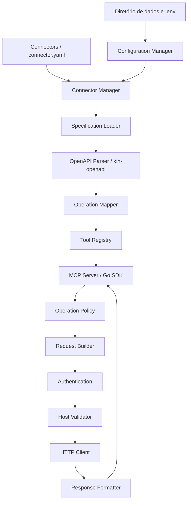

# Arquitetura

## Visão em camadas



## Organização de código proposta

```text
openapi-mcp/
├── cmd/server/main.go
├── internal/
│   ├── app/                 # composição e ciclo de vida
│   ├── config/              # diretório de dados e .env
│   ├── connector/           # manifesto, descoberta e validação
│   ├── openapi/             # carregamento e adaptação kin-openapi
│   ├── tools/               # mapeamento e registro de operações
│   ├── mcpserver/           # integração com SDK MCP
│   ├── execution/           # política, request e response
│   ├── auth/                # autenticação genérica
│   └── security/            # validação de destino e limites
├── docs/
├── examples/
└── go.mod
```

Os nomes são indicativos. Não é necessário criar um pacote para cada classe conceitual: por exemplo, `SpecificationLoader`, `SpecificationParser` e `ReferenceResolver` podem ser serviços internos do pacote `openapi`, sem diretórios próprios.

## Dependências e compatibilidade

Versões de referência consultadas em 02/11/2026:

| Componente | Versão de referência | Uso |
|---|---:|---|
| Go | 1.27.3 | Toolchain de compilação |
| `github.com/modelcontextprotocol/go-sdk` | v1.8.0 | Servidor MCP e transporte stdio |
| `github.com/getkin/kin-openapi` | v0.152.0 | Leitura, validação e modelo OpenAPI |
| `gopkg.in/yaml.v3` | v3.0.1 | Leitura dos manifestos |
| `net/http` | biblioteca padrão | Cliente HTTP |

O SDK MCP v1.8.0 é a versão estável identificada e implementa a revisão MCP 2026-07-28, mantendo compatibilidade com revisões anteriores documentadas pelo projeto. O `kin-openapi` oferece o modelo OpenAPI e carregadores/validadores; deve ser a única implementação de parsing OpenAPI no MVP. `yaml.v3` permanece na linha v3.0.1. Confirmar requisitos mínimos de Go e compatibilidade transitiva ao inicializar o módulo e executar testes de build; esta documentação não fixa ainda um `go.mod`.

Referências oficiais:
- https://go.dev/dl/
- https://github.com/modelcontextprotocol/go-sdk
- https://github.com/getkin/kin-openapi
- https://gopkg.in/yaml.v3

## Decisões arquiteturais

### 1. OpenAPI como fonte de contrato

O `kin-openapi` carrega e valida o documento, resolve referências suportadas e fornece o modelo tipado. O projeto não implementará um parser OpenAPI paralelo. A camada interna pode adaptar o modelo da biblioteca para uma representação de operação independente do SDK MCP, sem duplicar todo o documento.

### 2. Responsabilidade do mapeamento

`OperationMapper` transforma uma operação OpenAPI em uma definição interna de ferramenta: nome, descrição, JSON Schema de entrada e referência à operação. Não executa HTTP e não registra diretamente no SDK.

### 3. Registro e exposição

`ToolRegistry` mantém o índice nome MCP → operação/conector e detecta colisões. `MCPServer` registra no SDK as definições fornecidas pelo registry e encaminha chamadas ao executor. O SDK gerencia o protocolo, validação de mensagens e transporte.

### 4. Execução

`OperationExecutor` coordena policy → request builder → autenticação → validação de destino → HTTP → response formatter. Não é necessário um componente `HttpClient` próprio como abstração extensa: um cliente `net/http` configurado e injetado é suficiente.

### 5. Configuração e conectores

O `ConfigurationManager` resolve diretório de dados e `.env`. O `ConnectorManager` lê e valida manifestos, resolve variáveis `${VAR}` e produz configurações normalizadas. Não carrega nem interpreta OpenAPI.

### 6. Servidores OpenAPI

Se `server.url` estiver presente no conector, ele substitui os servidores da especificação. Caso contrário, selecionar o primeiro servidor aplicável após resolver variáveis de servidor com valores padrão definidos no documento. Se a seleção depender de variável sem default, o conector deve falhar com diagnóstico claro; não solicitar valores dinamicamente no MVP.

### 7. Nomes das ferramentas

Usar `operationId` quando presente, convertendo-o para `snake_case`. Na ausência, derivar de método + path normalizado. Prefixar com `tools.prefix`. Exemplo: `woocommerce_get_products`. Normalizar para caracteres permitidos pelo MCP. Colisões após normalização são erro de inicialização para o conector afetado; não sobrescrever silenciosamente.

### 8. Operações não suportadas

Uma operação que dependa de serialização ou conteúdo ainda não suportado não deve gerar uma ferramenta executável incorreta. Registrar diagnóstico com conector, método, path e motivo; ignorar somente a operação incompatível, mantendo as demais quando possível. Erros estruturais do documento ou colisões de nomes impedem o registro do conector.

## Concorrência e ciclo de vida

O servidor pode atender chamadas concorrentes. Clientes HTTP e definições de operações são compartilhados; dados mutáveis por chamada são locais à execução. O MVP carrega conectores e ferramentas na inicialização, sem hot reload. Alterações em arquivos exigem reinicialização.

## Distribuição

Compilar binários por GOOS/GOARCH em pipeline de release. O binário não depende do diretório do projeto, de Go instalado ou de arquivos de desenvolvimento. `.env`, conectores, especificações locais e logs ficam no diretório de dados. Substituir o binário não modifica esse diretório.
