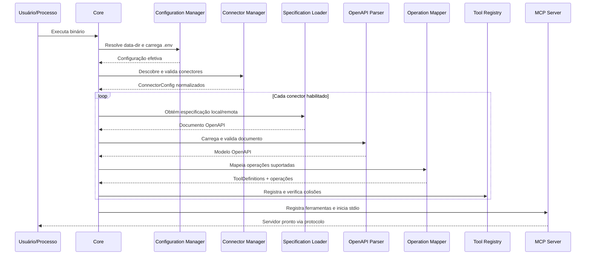
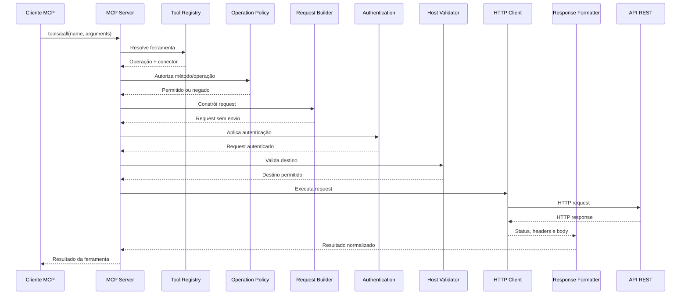

# Fluxo de inicialização e execução

## Inicialização

Etapas detalhadas:

1. Interpretar argumentos CLI e resolver `--data-dir`.
2. Carregar `.env` do diretório de dados.
3. Aplicar precedência do ambiente do processo e defaults.
4. Validar diretórios e criar somente os diretórios operacionais necessários, quando apropriado.
5. Descobrir diretórios de conectores e carregar manifestos.
6. Validar campos, IDs, permissões e autenticação; resolver `${VAR}`.
7. Obter cada especificação por caminho local ou URL remota, com limites e validação de destino.
8. Carregar e validar o documento com `kin-openapi`; resolver `$ref` internos.
9. Determinar o servidor base efetivo.
10. Mapear operações suportadas para schemas de entrada MCP.
11. Registrar ferramentas e detectar nomes duplicados.
12. Criar servidor MCP e iniciar transporte `stdio`.

## Chamada de ferramenta

A ordem efetiva de validação deve garantir que política e validação de destino ocorram antes do envio. O Request Builder não realiza I/O.

## Parâmetros e serialização

- `path`: substituir placeholders `{name}` com valores escapados conforme o path.
- `query`: serializar conforme `style`/`explode` da especificação nos casos implementados.
- `header`: adicionar valores sem permitir injeção de CR/LF.
- `cookie`: fora do MVP, salvo necessidade concreta.
- `requestBody`: JSON no MVP, respeitando o media type selecionado.

Parâmetros ausentes obrigatórios causam erro de validação antes do HTTP. Parâmetros opcionais ausentes são omitidos. Valores não devem ser convertidos por concatenação textual sem respeitar o tipo e a serialização OpenAPI.

## Seleção de request body

Quando houver mais de um media type, escolher um compatível com o conteúdo fornecido e suportado. No MVP, suportar `application/json` e `+json`. Se a operação só aceitar formatos não implementados, não publicar a ferramenta como executável e registrar o motivo.

## Respostas HTTP

- Resposta JSON: interpretar e retornar conteúdo estruturado quando possível, preservando representação textual serializada como fallback.
- Texto: retornar como conteúdo textual.
- Binário: não retornar bytes arbitrários diretamente como texto; no MVP, informar que o tipo de resposta não é suportado ou retornar metadados seguros. Download binário completo fica para evolução.
- Status não-2xx: retornar resultado de ferramenta indicando erro HTTP, status e corpo de erro limitado; não converter automaticamente em erro de protocolo JSON-RPC.
- Falha de transporte, timeout, DNS ou TLS: retornar erro de execução controlado.

## Limites de resposta

Definir limite configurável ou constante inicial para bytes lidos e caracteres retornados. Se excedido, truncar com indicação explícita; não consumir memória sem limite. A política exata e o valor inicial devem ser fechados durante a implementação e cobertos por testes.

## Content types e arquivos

O Request Builder deve selecionar o media type declarado pela operação e suportado pelo executor. A evolução prevista considera:

| Content type | Tratamento planejado | Situação no MVP |
|---|---|---|
| `application/json` e `application/*+json` | Serialização JSON respeitando schema | Incluído |
| `text/plain` | Corpo textual UTF-8 | Fora do MVP inicial, salvo caso simples necessário |
| `application/x-www-form-urlencoded` | Campos codificados conforme regras do formulário | Posterior |
| `multipart/form-data` | Campos textuais e partes de arquivo; boundary gerado pelo cliente HTTP | Posterior |
| `application/octet-stream` | Conteúdo binário | Posterior |

Para multipart, o boundary deve ser gerado pelo cliente HTTP; não definir manualmente um header `Content-Type` sem o boundary correspondente. A composição deverá respeitar o schema OpenAPI e distinguir campos textuais de partes binárias.

O servidor não deve presumir que um caminho como `/home/usuario/arquivo.pdf` exista ou seja acessível na máquina do servidor: o processo pode estar rodando em outro host e o transporte MCP não transfere automaticamente arquivos locais do cliente. Uma evolução poderá receber conteúdo por blocos binários suportados pelo protocolo/SDK ou por representação base64 com limites explícitos, ou usar referências de recursos acessíveis ao servidor. A escolha deve ser validada contra as capacidades reais do SDK e dos clientes MCP utilizados.

Para downloads, não devolver bytes arbitrários como texto. Uma evolução deverá escolher entre conteúdo binário em bloco MCP, recurso referenciado ou armazenamento temporário controlado com política de expiração e acesso.
